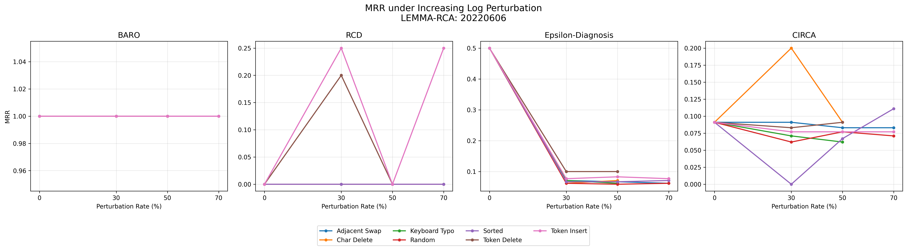
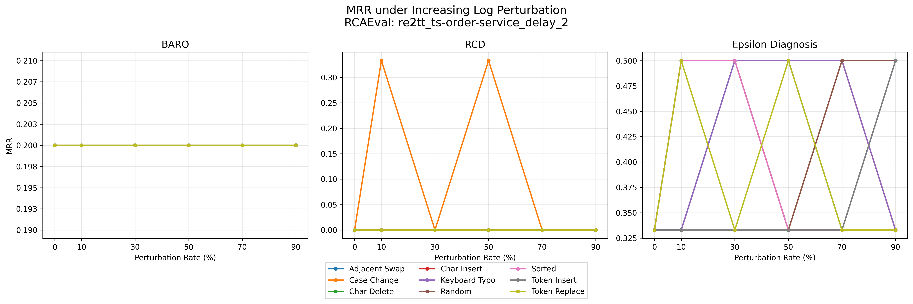

# Exploration of Log Data Properties for Testing the Robustness of Root Cause Analysis

This repository contains the source code and experimental framework developed for the bachelor’s thesis **“Exploration of Log Data Properties for Testing the Robustness of Root Cause Analysis”** at Leibniz University Hannover.

The project investigates how controlled modifications of textual log messages influence the ability of Root Cause Analysis (RCA) methods to identify the correct root cause.

## What is inside?
-  **Log fuzzing framework** — systematically modifies textual log messages while preserving selected structured information such as timestamps, IP addresses, UUIDs, numbers, paths, and other structured tokens.
-  **Log parsing** — uses Drain3 to transform raw log messages into structured log events.
-  **Feature extraction** — generates log-frequency and log-golden-signal features used by the RCA methods.
-  **RCA methods** — evaluates multiple RCA approaches under different log perturbations:
- BARO
- RCD
- $\epsilon$-Diagnosis
- CIRCA
-  **Evaluation framework** — calculates metrics such as Precision@K, Mean Reciprocal Rank (MRR), and MAP@K.
-  **Datasets**:
- LEMMA-RCA
- RCAEval
-  **Experimental results** — contains the scripts and configuration used to reproduce the experiments described in the thesis.

  
---

## Experimental Pipeline

The experiments follow the general pipeline:


```text
Raw Logs
│
▼
Log Preparation (json2message_lemma_rca.py | rcaeval2message_rcaeval.py)
│
▼
Log Fuzzing
│
▼
Drain3 Log Parsing
│
▼
Feature Extraction
│
├── Log Frequency
│
└── Log Golden Signal
│
▼
Root Cause Analysis
│
├── BARO
├── RCD
├── ε-Diagnosis
└── CIRCA
│
▼
Evaluation
│
├── Precision@K
├── MRR
└── MAP@K
```
The fuzzing step is performed before log parsing so that changes to the textual log messages can influence the resulting structured log events and extracted features.

---

## Log Fuzzing

The fuzzing framework applies controlled modifications to log messages.

### Character-level perturbations
The following character-level modes are implemented:
```text
random
sorted
adjacent_swap
char_delete
char_insert
keyboard_typo
case_change
```

### Token-level perturbations
The following token-level modes are implemented:
```text
token_delete
token_replace
token_insert
```


The perturbation probability can be configured for different rates, for example:
```text
10%, 30%, 50%, 70%, 90%
``` 

The fuzzer uses a fixed random seed 42 when required so that experiments can be reproduced.
Structured tokens can be protected from modification. These include information such as:
- timestamps
- IP addresses
- UUIDs
- MAC addresses
- URLs
- email addresses
- hexadecimal identifiers
- numbers and values with units
- file paths
-  `key=value` structures
- stack-trace related information

The purpose is to investigate the influence of textual log modifications while avoiding unintended changes to important structured information.

---
 

## Datasets
The experiments use datasets from **LEMMA-RCA** and **RCAEval**.
 

### LEMMA-RCA
The LEMMA-RCA experiments use selected cases from the Product Review dataset. The dataset used in this work was obtained from Hugging Face and is used in accordance with the license specified by the dataset authors.
The evaluated cases include:
```text
20220606
```

### RCAEval
RCAEval cases are used to evaluate the robustness of the RCA methods under additional log perturbations.

```text
re2tt_ts-order-service_delay_2
```

The RCAEval dataset is used in accordance with its applicable license and attribution requirements.

---

## RCA Methods
The following RCA methods are evaluated:
BARO, RCD $\epsilon$-Diagnosis, Circa

## Evaluation Metrics
The experimental results are evaluated using ranking-based metrics.

### Precision@K
Precision@K measures whether the correct root cause appears among the top `K` predicted components.
The experiments consider:
```text
Precision@1, Precision@5, Precision@7, Precision@10
```

### Mean Reciprocal Rank (MRR)
MRR evaluates the position of the correct root cause in the predicted ranking. A higher MRR indicates that the correct root cause tends to appear closer to the top of the ranking.

### MAP@K
Mean Average Precision at K is used to evaluate the quality of the predicted rankings up to a specified rank.
 

## Set-up

1. Install miniconda

```bash
$  mkdir  -p  ~/miniconda3
$  curl  https://repo.anaconda.com/miniconda/Miniconda3-latest-MacOSX-arm64.sh  -o ~/miniconda3/miniconda.sh
$  bash  ~/miniconda3/miniconda.sh  -b  -u  -p  ~/miniconda3
$  rm  -rf  ~miniconda3/miniconda.sh
``` 
  
2. Initialize `miniconda` for bash / zsh shells
```bash
$  ~/miniconda3/bin/conda  init  bash
$  ~/miniconda3/bin/conda  init  zsh
```
 

3. Create `venv` virtual environment and activate it
```bash
$  conda  create  --name  venv  python=3.8  -y
$  conda  activate  venv
$  pip  install  -r  requirements.txt
```


The exact dependencies required for individual RCA methods may differ.

## Experimental Pipeline
 
The following steps describe the general workflow used to prepare the datasets, perturb the log messages, extract features, and perform root cause analysis.
 

### Step 1: Download the datasets
 
Download the **LEMMA-RCA 20220606** dataset and the **RCAEval** dataset from their respective official sources.  

The experiments use the LEMMA-RCA `20220606` case and the RCAEval `re2tt_ts-order-service_delay_2` case.

### Step 2: Prepare the log data

Extract the required information from the original log files, such as pod names, node names, timestamps, and log messages.

For LEMMA-RCA:
```bash
python  json2message_lemma_rca.py
```


For RCAEval:
```bash
python  rcaeval2message_rcaeval.py
```


The scripts support arguments for specifying the input and output directories. For example:
  

```text
--path
Input directory containing the JSON-format log data.
 
--output_dir
Output directory for the extracted log messages.

--output_dir2
Output directory for pod-level log messages for each pod.

--output_dir3
Output directory for node-level log messages for each node.
```
 

**Note:** The paths and other arguments may need to be adjusted according to the local dataset and directory structure.

  
### Step 3: Run the log fuzzer


The log fuzzer supports both character-level and token-level perturbations.
For example:
```bash
python  log_fuzzer.py  \
--input_dir /path/to/input_logs \
--output_dir  /path/to/fuzzed_logs  \
--stats_dir /path/to/statistics \
--mode  random  \
--probability 0.3 \
--seed  42
```


The available perturbation modes are:

```text
random, sorted, adjacent_swap, char_delete, char_insert, keyboard_typo, case_change, token_delete, token_replace, token_insert
```
For example, `--probability 0.3` corresponds to a perturbation probability of 30%.

### Step 4: Parse the logs with Drain3

The fuzzed pod-level log messages are parsed using **Drain3**.
For example:
```bash
python  drain3_parse.py  \
--input_dir ./output/log_prep_pod/ \
--output_dir  ./drain3_result/pod
```


### Step 5: Extract log features
The structured logs generated by Drain3 are used to extract the features required by the RCA methods.
The repository contains separate feature-extraction directories for **LEMMA-RCA** and **RCAEval**
#### Log frequency
```bash
python  log_frequency_extraction.py  \
--log_dir ./input_path/ \
--output_dir  ./output_path/  \
--dataset_name 20220606
```


#### Log golden signal
```bash
python  log_golden_frequency.py  \
--log_dir ./input_path/ \
--output_dir  ./output_path/  \
--dataset_name 20220606
```

The resulting feature representations are subsequently used as inputs to the RCA methods.

### Step 6: Run the RCA methods

The extracted log features are provided to the evaluated RCA methods:
For LEMMA-RCA
```bash
python  baro_main_log_lemma.py  --case  20220606
python  rca_methods_log_lemma.py  --case  20210517  --model  rcd
The  rca_methods_log_lemma.py  script  should  be  adjusted  for  rcd,  circa,  and  epsilon_diagnosis  specifying  the  output  directories.
```


For RCAEval

```bash
python  baro_main_log_rcaeval.py  --case  "re2tt_ts-order-service_delay_2"  \
--feature_dir ./input_path/ \
--injection_time  1706067125  \
--root_cause "ts-order-service" \
--output_dir  ./output_path/

python  rca_methods_log_rcaeval.py  --case  "re2tt_ts-order-service_delay_2"  \
--feature_dir ./input_path/ \
--injection_time  1706067125  \
--root_cause "ts-order-service" \
--model  epsilon_diagnosis

The  rca_methods_log_rcaeval.py  script  should  be  adjusted  for  rcd  and  epsilon_diagnosis  specifying  the  output  directories.
```

The avaiable methods are:

```text
BARO, RCD, ε-Diagnosis, CIRCA
```
The corresponding RCA scripts are used to generate ranked lists of potential root causes. 

### Step 7: Evaluate the RCA results
The predicted root-cause rankings are compared with the ground-truth root causes.
```text
python baseline_evaluation.py --dataset rcaeval --method baro

For RCAEVAL, methods available are baro, rcd, and epsilon-diagnosis.
```
```text
python baseline_evaluation.py --dataset lemma --method baro

For LEMMA-RCA, methods available are baro, rcd, circa, and epsilon-diagnosis.
```
The resulting evaluation values are used to analyze the robustness of the RCA methods under different log perturbation types and perturbation rates.

---

## Experimental Results


The experiments investigate two aspects of robustness:

1.  **Stability:** Does the RCA result remain stable after the log messages are perturbed?
2.  **Diagnostic usefulness:** Does the RCA method still correctly identify the root cause after perturbation?

Considering only stability can be misleading. A method that consistently produces incorrect results could appear stable even though it is not diagnostically useful.

Therefore, the experimental analysis considers both the change in RCA results and the resulting diagnostic performance.

---


## Key Results

```
The experiments show clear differences in the robustness of the evaluated RCA methods. Robustness is considered from two perspectives: stability of the RCA result and diagnostic usefulness.

LEMMA-RCA
BARO showed substantially more stable and diagnostically useful results under the evaluated perturbations, while the other RCA methods were more strongly affected by changes to the log messages.



RCAEval
The RCAEval experiments provide an additional evaluation of the effect of controlled log perturbations on RCA performance.



```

## Reproducibility
The experiments use fixed configuration parameters and fixed random seeds 42.
The main experimental variables include:

```text
Dataset
RCA method
Fuzzing mode
Perturbation rate
Random seed
Feature type
``` 

Generated experimental results can be reproduced by applying the same preprocessing, fuzzing, feature extraction, RCA, and evaluation configurations described in the thesis.

Because some of the datasets and RCA pipelines require substantial computational resources, the complete raw datasets and all generated intermediate files are not included in this repository.

---

## Thesis
The complete experimental methodology, implementation details, and results are documented in the bachelor’s thesis:

>  **Sanjeeb Shrestha**, *Exploration of Log Data Properties for Testing the Robustness of Root Cause Analysis*.
> Bachelor’s Thesis, Leibniz University Hannover, 2026.

The thesis provides detailed descriptions of:
- the experimental methodology,
- log perturbation strategies,
- Drain3-based log parsing,
- feature extraction,
- RCA methods,
- evaluation metrics,
- experimental results,
- robustness analysis, and
- limitations and future work.
---

## Limitations

The experiments are subject to several limitations.
- The evaluation is based on selected datasets and cases.
- Some RCA methods require substantially more computational resources than others.
- The internals of external RCA implementations are not modified unless explicitly described in the thesis.
- The experiments focus on controlled textual perturbations and therefore do not represent every type of variation that can occur in production logging environments.
- Some generated intermediate data can be very large and is therefore not stored in this repository.

---


## Future Work

Possible directions for future work include:

- evaluating additional datasets and RCA methods,
- investigating additional log perturbation strategies,
- combining multiple perturbation types,
- evaluating more realistic logging variations,
- improving the efficiency of the experimental pipeline,
- investigating the influence of different feature representations, and
- extending the robustness analysis to larger and more diverse datasets.

---

  
## Acknowledgments

This work was conducted at the **Institute for Systems Engineering, Leibniz University Hannover**, under the supervision of **Stefan Petrescu** and **Professor Dr. Jan Rellermeyer**.

The experiments using the LEMMA-RCA dataset build upon the original **LEMMA-RCA** framework and its publicly available reproducibility code. The code was adapted where necessary for the experimental setup of this thesis, including the log perturbation and evaluation pipeline. The original LEMMA-RCA work and dataset are acknowledged and cited accordingly. Original LEMMA-RCA Paper Lecheng Zheng, Zhengzhang Chen, Dongjie Wang, Chengyuan Deng, Reon Matsuoka, and Haifeng Chen. “LEMMA-RCA: A Large Multi-modal Multi-domain Dataset for Root Cause Analysis.” In: CoRR abs/2406.05375 (2024) https://arxiv.org/pdf/2406.05375.

For the **RCAEval** experiments, the `re2tt_ts-order-service_delay_2` dataset from RCAEval is used as an evaluation dataset. The original dataset is cited accordingly. Luan Pham, Hongyu Zhang, Huong Ha, and Flora Salim. “RCAEval: A Benchmark for Root Cause Analysis of Microservice Systems with Telemetry Data.” In: Companion Proceedings of the ACM on Web Conference 2025. 2025. DOI: 10.1145/3701716.3715290. URL: https://dl.acm.org/doi/10.1145/3701716.3715290.

The project also uses **Drain3** for log parsing and builds upon existing RCA implementations and software packages. The corresponding original projects, publications, and licenses are acknowledged where applicable.

---

## License and Third-Party Software
This repository contains original thesis code as well as code that builds upon or interfaces with external projects.

The repository uses or builds upon third-party software and implementations, including **BARO, RCD, ε-Diagnosis, CIRCA, and Drain3**. These components remain subject to their respective licenses.

The datasets used in the experiments, including **LEMMA-RCA** and **RCAEval**, are third-party resources and remain subject to their respective dataset licenses and attribution requirements.

Applicable third-party license and attribution notices are provided in the `THIRD_PARTY_LICENSES/` directory where required. Please also refer to the individual source files and the corresponding project documentation for additional attribution and licensing information.